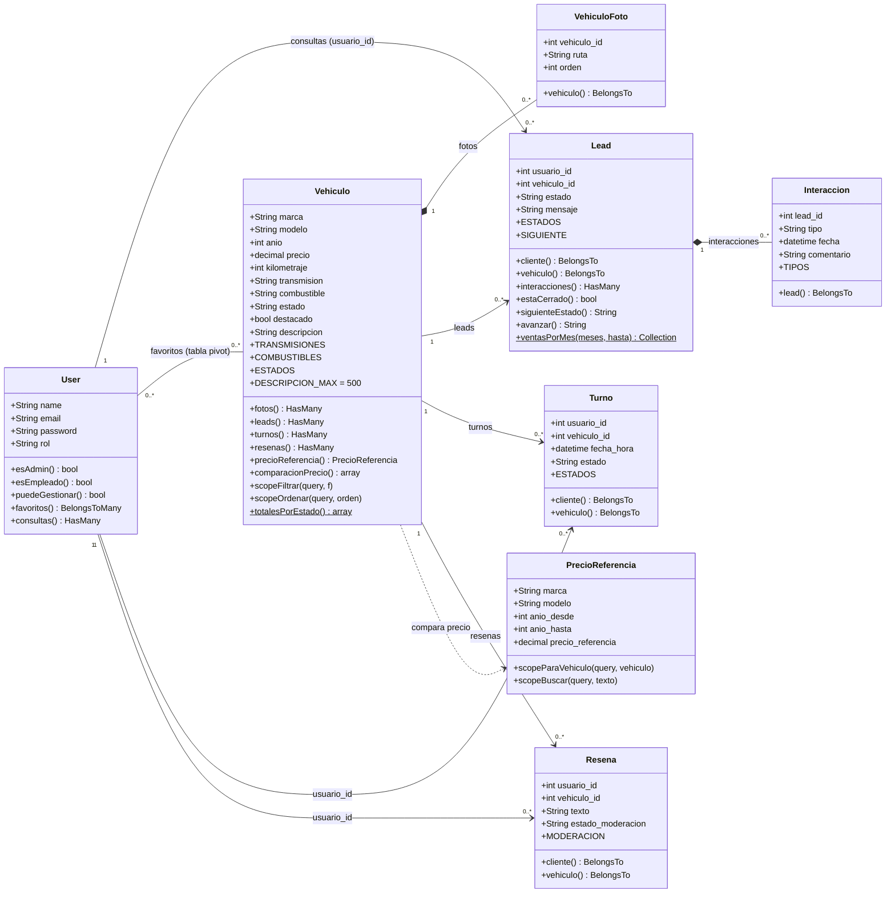

# Diagrama de clases UML — AutoNova Motors

> Fuente: código de `app/` en la rama `main` (commit 326cc50, 17/11/2026).
> Los atributos son los de `$fillable` de cada modelo; `id` y `timestamps` se omiten.
> GitHub renderiza este bloque Mermaid directamente.
> Trazabilidad: ISO/IEC/IEEE 29148 (RF ↔ clase), ISO/IEC 25010 (mantenibilidad: modularidad).

## 1. Modelo de dominio (Eloquent)



Notas de lectura:

- `Turno` y `Resena` existen como modelo y tabla, pero **RF-13 (turnos) y RF-14 (reseñas) no tienen controlador ni rutas**: están marcados como "no implementado".
- `PrecioReferencia` no define relaciones Eloquent: se vincula con `Vehiculo` por marca, modelo y rango de años (`scopeParaVehiculo`).
- `favoritos` es una relación muchos a muchos con la tabla `favoritos` (claves `usuario_id` y `vehiculo_id`).
- Los valores de `rol` (`cliente`, `empleado`, `admin`) se usan como cadenas; no hay constantes de rol en `User`.

## 2. Capa de aplicación (controladores y middleware)

```mermaid
classDiagram
    direction TB

    class Controller {
        <<abstract>>
    }
    class HasMiddleware {
        <<interface>>
        +middleware()$ array
    }
    class EnsureRole {
        <<middleware, alias rol>>
        +handle(request, next, roles) Response
    }

    class AuthController {
        +create()
        +store(request)
        +destroy(request)
    }
    class RegistroController {
        +create()
        +store(request)
    }
    class VehiculoController {
        +index(request)
        +create()
        +store(request)
        +show(vehiculo)
        +edit(vehiculo)
        +update(request, vehiculo)
        +destroy(vehiculo)
    }
    class ConsultaController {
        +store(request, vehiculo)
        +mias(request)
        +index(request)
        +show(consulta)
        +avanzar(consulta)
    }
    class InteraccionController {
        +store(consulta)
    }
    class FavoritoController {
        +index(request)
        +store(request, vehiculo)
        +destroy(request, vehiculo)
    }
    class PrecioReferenciaController {
        +index(request)
    }
    class ReporteController {
        -PERIODOS = 3, 6, 12
        +ventas(request)
    }
    class UsuarioController {
        +index()
    }

    Controller <|-- AuthController
    Controller <|-- RegistroController
    Controller <|-- VehiculoController
    Controller <|-- ConsultaController
    Controller <|-- InteraccionController
    Controller <|-- FavoritoController
    Controller <|-- PrecioReferenciaController
    Controller <|-- ReporteController
    Controller <|-- UsuarioController
    HasMiddleware <|.. VehiculoController
    HasMiddleware <|.. ConsultaController
    HasMiddleware <|.. FavoritoController
    EnsureRole <.. VehiculoController : rol:empleado,admin / rol:admin
    EnsureRole <.. ConsultaController : rol:cliente / rol:empleado,admin
    EnsureRole <.. FavoritoController : rol:cliente
    EnsureRole <.. ReporteController : rol:admin (ruta)
    EnsureRole <.. UsuarioController : rol:admin (ruta)

    AuthController ..> User
    RegistroController ..> User
    VehiculoController ..> Vehiculo
    VehiculoController ..> VehiculoFoto
    ConsultaController ..> Lead
    ConsultaController ..> Vehiculo
    InteraccionController ..> Interaccion
    FavoritoController ..> User
    PrecioReferenciaController ..> PrecioReferencia
    ReporteController ..> Lead
    UsuarioController ..> User
```

Verificado en el código: `VehiculoController`, `ConsultaController` y `FavoritoController` implementan `HasMiddleware`. Los métodos de `RegistroController`, `InteraccionController`, `PrecioReferenciaController` y `UsuarioController` salen de `routes/web.php` y las dependencias con modelos de esos cuatro controladores son **inferidas por nombre: revisar contra el código antes de entregar**.
