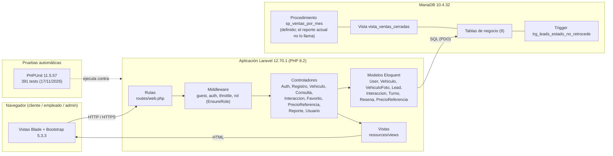
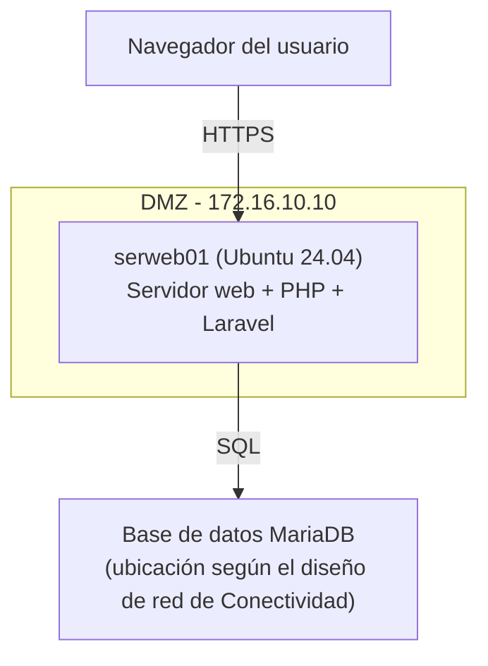

# Diagrama de componentes UML — AutoNova Motors

> Fuente: estructura de `app/`, `routes/`, `database/migrations/` y `resources/` en `main` (commit 326cc50), más los datos de red oficiales del proyecto.
> Mermaid no tiene un tipo "componentes" propio; se representa con un diagrama de bloques con subsistemas, que es la forma habitual en GitHub.

## 1. Componentes de la aplicación

## 2. Despliegue previsto (plan, no implementado)

Aclaración: serweb01 es el destino del plan de despliegue; **la aplicación no está desplegada ahí**. Hoy corre en XAMPP en la PC del equipo. Revisar con Redes (Pajares) dónde queda la base de datos antes de entregar este diagrama.

## 3. Dependencias entre componentes

| Componente | Depende de | Observación |
|---|---|---|
| Rutas | Middleware, controladores | Los roles se aplican en la ruta (reportes, usuarios) o dentro del controlador (`HasMiddleware`) |
| Controladores | Modelos, vistas | Sin capa de servicios: la lógica de negocio crítica está en `Lead::avanzar()` |
| Modelos | MariaDB | Relaciones Eloquent; el pivote `favoritos` une `User` y `Vehiculo` |
| Base de datos | Migraciones (15) | Incluye vista, trigger y procedimiento en `create_logica_en_servidor` |
