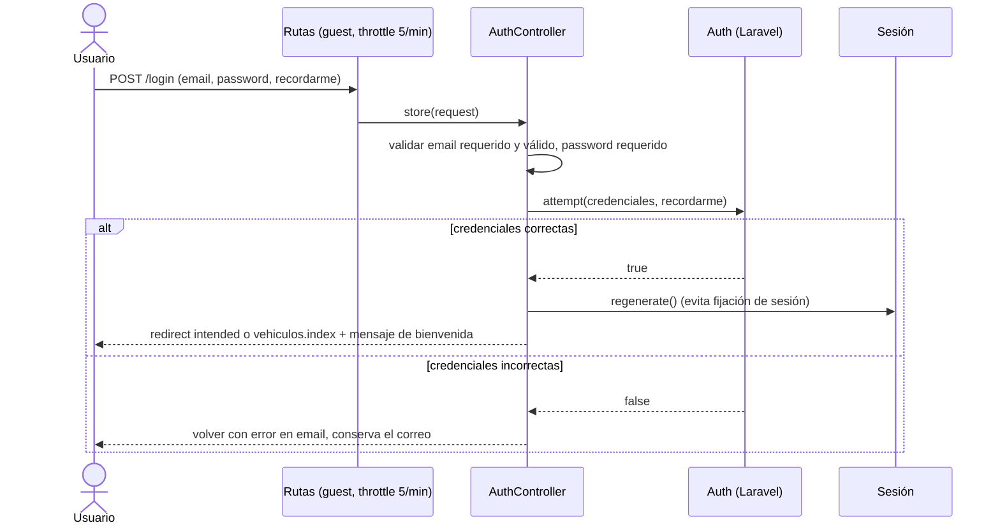
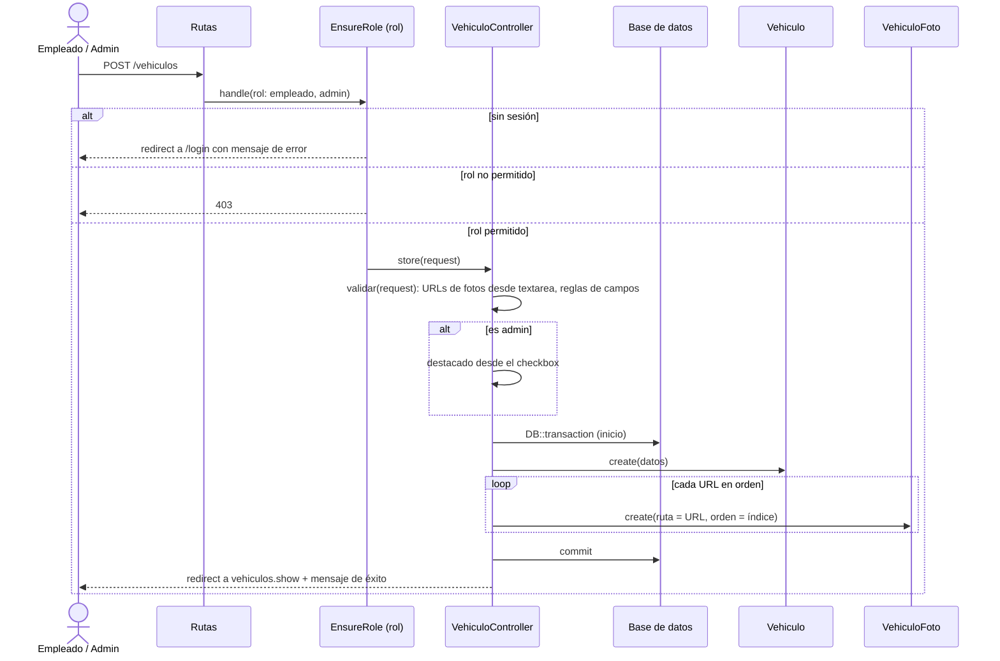
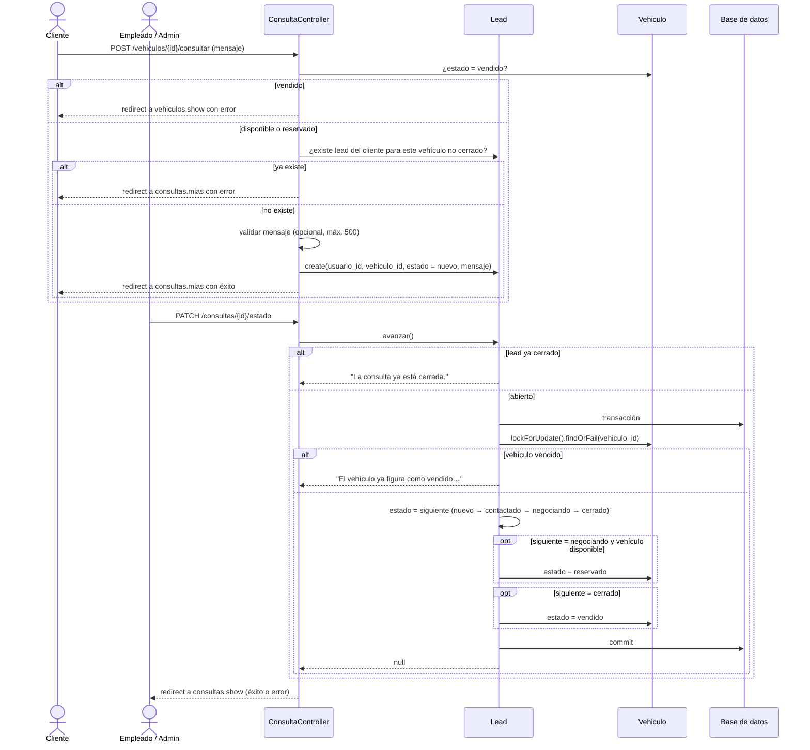

# Diagramas de secuencia UML — AutoNova Motors

> Fuente: `routes/web.php`, `AuthController`, `VehiculoController`, `ConsultaController`, `FavoritoController`, `ReporteController`, `EnsureRole` y `Lead` en `main` (commit 326cc50).
> Cada diagrama sigue el código tal como está, incluidos los casos de error.

## S1. Inicio de sesión (RF de autenticación)



Nota: el mismo mensaje cubre correo inexistente y contraseña errónea. El redirect no depende del rol.

## S2. Alta de vehículo (empleado o admin)



Nota: las fotos son URLs `http(s)`, no hay subida de archivos. Si la validación falla, Laravel devuelve al formulario con los errores.

## S3. Consulta de un cliente y avance de estado (RF-05 y RF-06)



Nota: el trigger `trg_leads_estado_no_retrocede` de la base rechaza cualquier actualización que haga retroceder el estado, como segunda barrera a nivel de datos.

## S4. Reporte de ventas por mes (solo admin)

```mermaid
sequenceDiagram
    actor Ad as Admin
    participant M as EnsureRole (rol:admin)
    participant C as ReporteController
    participant L as Lead
    participant DB as Base de datos

    Ad->>M: GET /reportes/ventas?meses=N
    M->>C: ventas(request)
    C->>C: meses = N si está en 3, 6 o 12; si no, 6
    C->>L: ventasPorMes(meses)
    L->>DB: leads cerrados entre desde y fin del último mes (con vehiculo.id, precio)
    DB-->>L: filas
    L->>L: agrupar por mes, sumar montos, calcular variaciones
    L-->>C: colección de filas
    C->>C: invertir (mes más nuevo primero), actual = fila 0, anterior = fila 1
    C-->>Ad: vista reportes.ventas
```

Hallazgos para revisar con Programación y Base de Datos:

- `ventasPorMes()` calcula en PHP con una consulta Eloquent. **No llama al procedimiento `sp_ventas_por_mes` ni a la vista `vista_ventas_cerradas`**, que existen en la migración de lógica en servidor. Si la documentación dice que el reporte usa el procedimiento, hay que corregir una de las dos cosas.
- Usa `updated_at` como fecha de venta: si se edita un lead cerrado, la venta puede cambiar de mes.
- El monto usa el precio actual del vehículo, no el precio al momento de la venta.
