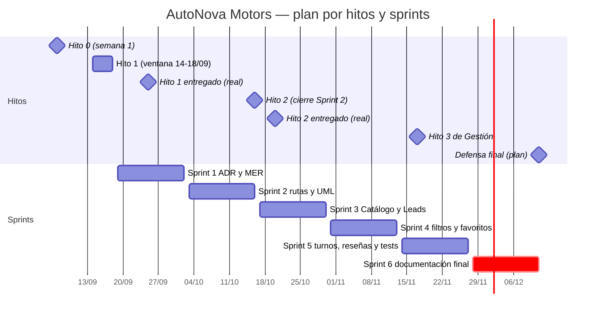

# Roadmap — AutoNova Motors (Servicio Automotriz)
Actualizado al 17/11/2026. Fuente: plan de sprints del Hito 1 (fechas planificadas), tablero del 16/11 e informe de Programación del 17/11.
Las fechas **planificadas** son las del plan; las **reales** se indican aparte. Donde la realidad difiere del plan, se muestra el desvío.

## 1. Hitos: planificado frente a real
| Hito | Planificado | Real | Desvío |
|---|---|---|---|
| Hito 0 — Programación y BD | Semana 1 (01-07/09) | Entregado (v1.0) a inicios de septiembre; fecha exacta sin registro | — |
| Hito 1 — Gestión y planificación | Ventana 14-18/09 | Entregado 25/09; v2 corregida 07/10 | +7 días (entrega) |
| Hito 2 — Diseño y trazabilidad | Cierre del Sprint 2: 16/10 | Entregado 20/10 | +4 días |
| Hito 3 — Entrega final | Hito 3 de Gestión: 17/11. Cierre del plan (Sprint 6, defensa): 11/12 | Hito 3 de Gestión en entrega el 17/11 | — |

## 2. Sprints (dos semanas cada uno)
| Sprint | Fechas | Objetivo | Resultado al 17/11 |
|---|---|---|---|
| 1 | 19/09-02/10 | ADR y modelo entidad-relación | MER hecho; **ADR abierto** |
| 2 | 03/10-16/10 | Rutas y endpoints; UML de casos de uso y clases | Casos de uso hechos; **endpoints abierto; clases a rehacer** |
| 3 | 17/10-30/10 | Módulos núcleo: Catálogo y Leads (RF-01 a RF-06) | Construidos hasta el 17/11 (el código no tuvo cambios entre el 22/10 y el 16/11) |
| 4 | 31/10-13/11 | Filtros, comparador, favoritos y destacados | Filtros, favoritos y destacados hechos; **comparador no construido** |
| 5 | 14/11-27/11 | Turnos, reseñas y suite de pruebas (>80 % de cobertura) | 391 pruebas aprobadas; **turnos y reseñas no construidos; cobertura sin medir** |
| 6 | 28/11-11/12 | Manual de usuario, guía de administrador, documentación final y defensa | **En curso** (issues abiertos) |

## 3. Diagrama de Gantt (planificado)

## 4. Issues abiertos (último hito)
Solo quedan abiertos los de **testing** (8), **diagramas UML** (3) y **documentación** (14). Ver `issues.csv`, columna `estado`.

| Grupo | Issues |
|---|---|
| Testing | cobertura >80 %; mapeo PU-01..13; capturas y seguridad en la PC; error 1451 en MariaDB; verificaciones del respaldo; usabilidad con usuarios; instalación en otro equipo; revisión de controles ISO 27001 |
| Diagramas UML | clases (alineado con 9 tablas); secuencia (consulta → cierre de venta); componentes |
| Documentación | ADR; rutas y endpoints; manual técnico unificado; revisión del manual de usuario; guía de administrador; docs/ en el repo; ESRE 29148 con RNF; PERT; supuestos y conclusiones; capturas de instalación; acta real; tablero; entrega del Hito 3; presentación y defensas |

## 5. Cómo verlo como Roadmap en GitHub Projects
1. En el Project, creá los campos de fecha **Start date** y **Target date** y el campo de texto **Fecha real**.
2. Creá una vista tipo **Roadmap**; agrupá por **Milestone** y usá Start/Target date como rango.
3. El script `crear_issues.sh` carga esas fechas a cada issue si le pasás `PROJECT_NUMBER`.
